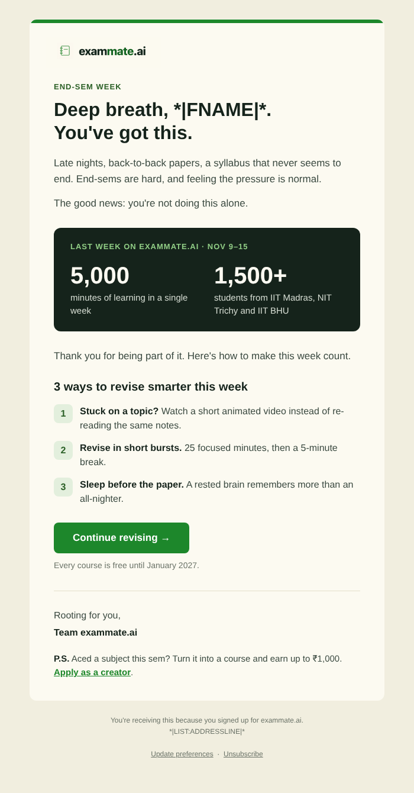
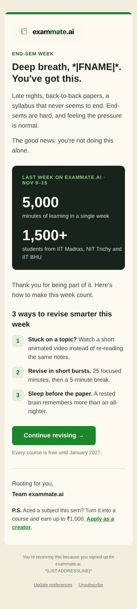

# exammate.ai end-sem email

A Mailchimp email for students during end-semester exams. It acknowledges the
stress, shares last week's milestone, gives three quick revision tips, and links back
to exammate.ai.

| Desktop | Phone |
| --- | --- |
|  |  |

## Files

```
email.html            The email, ready to paste into Mailchimp
exammate-logo.png     Logo shown at the top (upload this to Mailchimp)
preview-desktop.png   Screenshot at desktop width
preview-mobile.png    Screenshot at phone width
```

## Subject line and preview text

**Subject (recommended):** `*|FNAME|*, deep breath. You've got this 💚`

Other options:

- End-sems are tough. You're not studying alone.
- 1,500+ students revised on exammate.ai last week
- 5,000 minutes of learning in one week. Thank you!

**Preview text:** already built into the email: "1,500+ students from IIT Madras,
NIT Trichy and IIT BHU are revising on exammate.ai this end-sem." Leave Mailchimp's
preview text field empty.

## What's in the email

- **Opening:** "Deep breath, [first name]. You've got this.", plus two short lines
  acknowledging end-sem stress.
- **Milestone (Nov 9–15):** 5,000 minutes of learning in one week, and 1,500+ students
  from IIT Madras, NIT Trichy and IIT BHU.
- **3 revision tips:** watch a short animated video when stuck, revise in 25-minute
  bursts, sleep before the paper.
- **Button:** "Continue revising →", with a note that courses are free until
  January 2027.
- **P.S.:** creators can earn up to ₹1,000 per course.

## Sending it in Mailchimp

The steps are the same as the [relaunch email](../exammate-relaunch-2026/README.md#sending-it-in-mailchimp):

1. Use the same audience (first name mapped to `FNAME`). The first name appears in the
   heading, so check no first names are blank.
2. Upload `exammate-logo.png` to **Content → Content Studio** (or reuse the logo
   already uploaded for the relaunch email) and copy its URL.
3. In `email.html`, replace `src="exammate-logo.png"` with that URL.
4. Create the campaign: **Email → Code your own → Paste in code**, and paste the whole
   of `email.html`.
5. Add the subject line, send yourself a test, then send.

**Timing:** send it early in the morning or in the evening, when students take
breaks from revising, rather than during exam hours.

## Before sending, check

- **Numbers.** 5,000 minutes (Nov 9–15) and 1,500+ users are as provided. Confirm both
  are accurate, and that it's fine to name IIT Madras, NIT Trichy and IIT BHU.
- **Links.** Both links go to `https://www.exammate.ai/`. Point **Apply as a creator**
  at the creator application page if there is one.

Brand colours and merge tags are the same as the relaunch email; see its
[README](../exammate-relaunch-2026/README.md#merge-tags).
