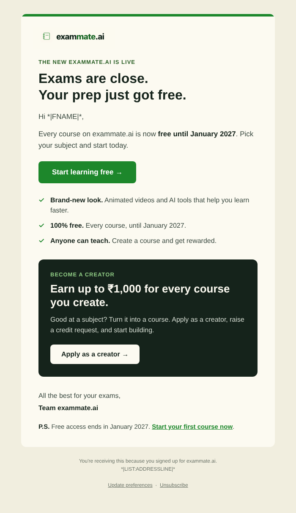
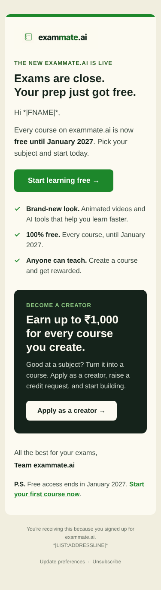

# exammate.ai relaunch email

A Mailchimp email announcing the relaunch of exammate.ai, for about 1,500 students.
It covers the new look, free courses until January 2027, and the creator programme
(earn up to ₹1,000 per course).

| Desktop | Phone |
| --- | --- |
|  |  |

## Files

```
email.html            The email, ready to paste into Mailchimp
exammate-logo.png     Logo shown at the top (upload this to Mailchimp)
preview-desktop.png   Screenshot at desktop width
preview-mobile.png    Screenshot at phone width
```

## Subject line and preview text

**Subject (recommended):** `*|FNAME|*, your exam prep just got free 🎓`

Other options:

- Exams are close. Prep free on the new exammate.ai
- Free courses till Jan 2027 + earn ₹1,000 as a creator
- Learn faster with animated videos and AI, free

**Preview text:** already built into the email: "Free courses until Jan 2027, plus earn
up to ₹1,000 for every course you create." You can leave Mailchimp's preview text
field empty.

To find the best subject, set the campaign up as an **A/B test** with two subjects
(for example the first and third above). Mailchimp sends each to a small group first
and sends the winner to the rest.

## Sending it in Mailchimp

1. **Import the contacts.** Upload the student list (first name, last name, email) to
   your audience. Map first name to `FNAME` and last name to `LNAME`.
   The email greets students by first name ("Hi Priya,"), so check that no first
   names are blank, or they'll see "Hi ,".
2. **Upload the logo.** Go to **Content → Content Studio**, upload
   `exammate-logo.png`, and copy its URL.
3. **Point the email at the logo.** In `email.html`, find
   `src="exammate-logo.png"` and replace `exammate-logo.png` with the URL from step 2.
4. **Create the campaign.** Choose **Email → Code your own → Paste in code** and paste
   the whole contents of `email.html`.
5. **Add the subject line** from above.
6. **Send a test** to yourself, and check it on a phone and on a computer.
7. **Send** to the full audience.

## Before sending, check

- **Links.** Every button links to `https://www.exammate.ai/`. If there's a separate
  creator application page, point **Apply as a creator** there instead.
- **Reward wording.** Confirm "up to ₹1,000 per course" matches the creator terms.
- **Free access date.** The email says courses are free "until January 2027".

## Merge tags

Codes like `*|FNAME|*` show as raw text when you open `email.html` in a browser.
Mailchimp replaces them when it sends:

| Tag | Becomes |
| --- | --- |
| `*\|FNAME\|*` | The student's first name |
| `*\|LIST:ADDRESSLINE\|*` | Your organisation's postal address (set in Mailchimp account settings; required by law) |
| `*\|UPDATE_PROFILE\|*` | Link for the student to update their preferences |
| `*\|UNSUB\|*` | Unsubscribe link |

## Brand

Colours come from the exammate.ai logo, not the Jam.education site:

| Use | Colour |
| --- | --- |
| Background | `#FCFAF1` (card), `#F1EEDF` (page) |
| Text | `#15231B` (headings), `#3B4A41` (body) |
| Buttons, links, top bar | `#1D872B` |
| Labels and badges | `#2D6128` |

## Editing

The email uses tables and inline styles because many email clients, including Gmail
and Outlook, ignore modern CSS. Keep that pattern when you change it: edit the text
inside the existing tags rather than restructuring the layout.
